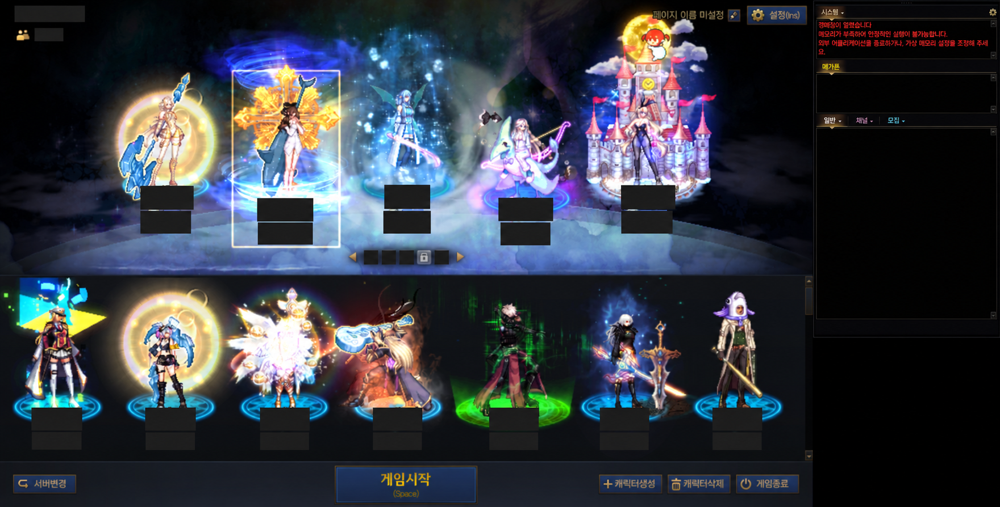
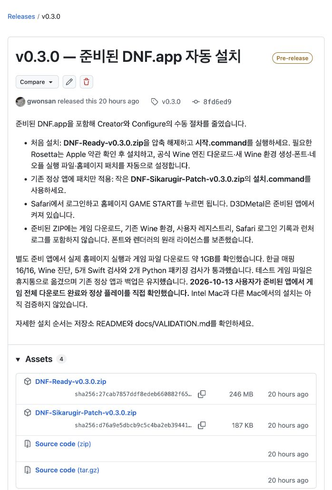
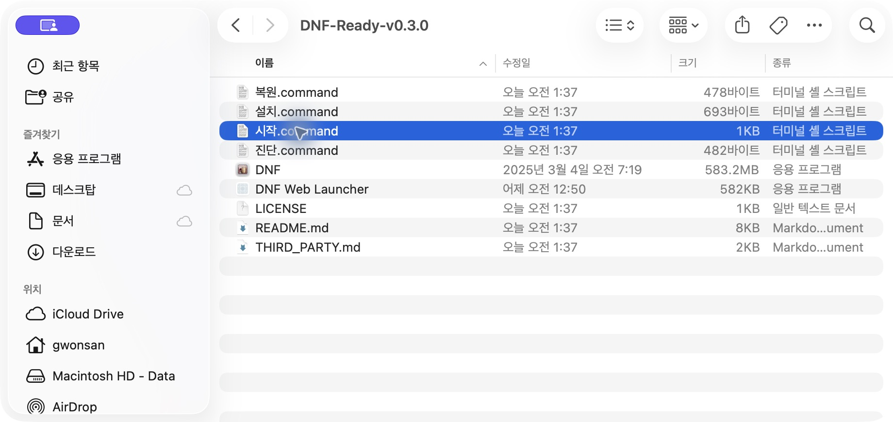
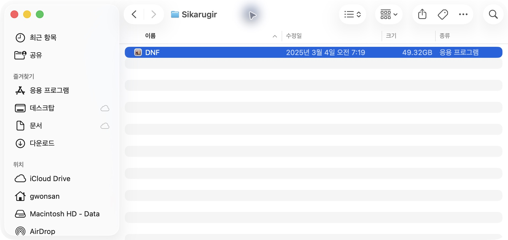
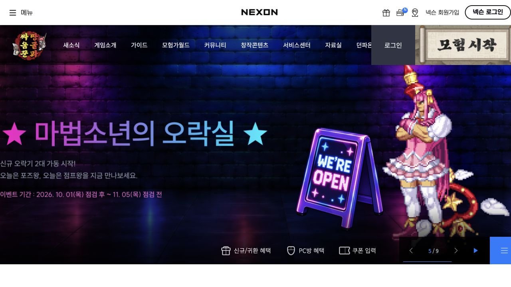

# DNF Sikarugir Patch

맥에서 Sikarugir로 한국 던전앤파이터를 설치하고 홈페이지의 **GAME START**로 실행하기 위한 도구입니다. **D3DMetal, 한글 폰트, 네오플 실행 파일과 홈페이지 연결**을 함께 준비합니다.



*Apple Silicon Mac · macOS 26.6.2 · Sikarugir Wine 11에서 캡처한 캐릭터 선택 화면. 계정·캐릭터 이름과 수치는 가렸습니다.*

2026-10-13 기준 Apple Silicon Mac · macOS 26.6.2 · Sikarugir Wine 11 환경에서 홈페이지 실행과 한글 표시가 정상 작동하며, **준비된 DNF.app에서도 게임 전체 다운로드 완료와 정상 플레이를 사용자가 직접 확인했습니다.** 검증 범위는 [VALIDATION.md](https://github.com/gwonsan/dnf-sikarugir-patch/blob/main/docs/VALIDATION.md)에 기록합니다.

## 가장 간단한 설치

1. [Releases](https://github.com/gwonsan/dnf-sikarugir-patch/releases)에서 `DNF-Ready-v0.3.0.zip`을 받아 압축을 풉니다.
2. 폴더 안의 `시작.command`를 더블클릭합니다. Rosetta가 없으면 Apple 설치 창의 약관을 확인하고 동의합니다. 이후 Wine 설치와 패치 적용은 자동으로 진행됩니다.
3. 열린 던파 홈페이지에서 **Safari로 로그인하고 GAME START**를 누릅니다. 브라우저의 외부 앱 실행 확인을 허용하고 게임을 내려받습니다.

**[60초 설치 안내 영상 다운로드 · MP4](https://github.com/gwonsan/dnf-sikarugir-patch/releases/download/v0.3.0/DNF-Install-Guide-v0.3.0.mp4)**

실제 화면 캡처와 단계별 자막으로 만든 요약 영상입니다. 파일 다운로드·자동 설치·게임 다운로드에는 별도의 시간이 필요합니다.

<details>
<summary><strong>설치 화면 4장으로 따라하기</strong></summary>

### 1. 준비된 ZIP 다운로드

[v0.3.0 배포 페이지](https://github.com/gwonsan/dnf-sikarugir-patch/releases/tag/v0.3.0)의 **Assets → DNF-Ready-v0.3.0.zip**을 선택합니다. 처음 설치할 때는 준비된 DNF.app이 포함된 큰 ZIP을 받으세요.



### 2. 압축을 풀고 시작.command 실행

받은 ZIP을 더블클릭해 압축을 푼 뒤, 폴더 안의 **시작.command**를 더블클릭합니다. 필요한 파일을 폴더 안에 함께 둔 상태로 실행하세요.



### 3. 자동 설정 완료 기다리기

Rosetta가 없으면 Apple 약관을 확인하고 직접 동의합니다. Wine 설치, 새 Wine 환경 생성, 폰트·네오플 실행 파일·홈페이지 연결은 자동으로 진행됩니다. 터미널에 다음 메시지가 나오면 다음 단계로 넘어갑니다.

> 설정 완료. 열린 던파 홈페이지에서 로그인하고 GAME START를 눌러 주세요.

기본 설치 위치는 **사용자 홈 → Applications → Sikarugir → DNF.app**입니다. 아래는 정상 설치된 앱의 위치 예시입니다. 촬영한 앱에는 이미 게임 파일이 내려받아져 있어 설치 직후보다 크기가 큽니다.



### 4. Safari 로그인 후 홈페이지에서 실행

[던파 홈페이지](https://df.nexon.com)를 Safari로 열고 로그인합니다. 오른쪽 위의 **모험시작** 버튼(GAME START)을 누르고 외부 앱 열기를 허용하세요. 네오플 창에서 설치 경로를 확인한 뒤 게임 다운로드를 진행합니다. 다운로드가 끝나면 게임에 접속할 수 있습니다.



로그인 입력과 OTP 인증은 직접 진행하세요. 안내 화면에는 로그인 정보와 인증번호를 담지 않았습니다.

</details>

Sikarugir Creator에서 빈 앱을 만들거나 Configure를 열고 플러그인 설치 버튼을 누르는 절차를 미리 준비한 패키지입니다. 기본 설치 위치는 `~/Applications/Sikarugir/DNF.app`입니다. Xcode나 별도 Wine 설치 명령은 필요하지 않습니다.

필요한 환경은 macOS 14.6 이상과 인터넷 연결입니다. Apple Silicon에서는 Rosetta를 사용합니다. 게임용 저장공간은 [공식 다운로드 안내](https://df.nexon.com/data/client)를 확인하세요. 패치 도우미는 임시 서명을 사용하며 Apple 공증은 되어 있지 않습니다. macOS가 명령 파일을 차단하면 **시스템 설정 → 개인정보 보호 및 보안 → 확인 없이 열기**에서 해당 파일을 허용하세요.

## 준비된 앱에 들어 있는 것

| 준비된 ZIP에 포함 | 설치 시 준비하거나 사용자가 진행 |
| --- | --- |
| 공식 Sikarugir Template 1.0.21의 앱과 Configure | 공식 Wine 11 엔진 다운로드 및 SHA-256 검증 |
| D3DMetal 설정과 템플릿의 렌더러·라이선스 | 이 Mac에 맞는 새 Wine 환경 생성 |
| Source Han Sans 폰트와 SIL OFL 라이선스 | 일본어·한글 폰트 등록 및 홈페이지 실행 연결 |
| 공식 네오플 실행 파일 두 개와 패치 도우미 | 필요한 경우 Rosetta 약관 동의 |
| 설치·복원·진단 명령 파일 | Safari 로그인과 GAME START, 게임 다운로드 |

게임 파일, Wine 엔진, 기존 Mac의 Wine 레지스트리·사용자 환경과 런처 로그는 배포본에 포함하지 않습니다. 공식 템플릿에 필요한 파일 세 개만 넣고, Wine 환경은 설치받는 Mac에서 새로 만듭니다. **Safari 쿠키와 로그인 기록은 앱에 복사하지 않습니다.** 홈페이지에서 받은 실행 요청은 공식 네오플 실행 파일에 그대로 전달하며 패치 도우미는 인증 URL을 기록하지 않습니다.

폰트는 Configure의 `fakejapanese`와 같은 Source Han Sans 및 일본어 매핑을 등록하고, 한글 글꼴 대체 이름 16개를 Source Han Sans K로 연결합니다. D3DMetal은 미리 켜져 있습니다. 배포 구성과 각 파일의 출처·라이선스는 [THIRD_PARTY.md](THIRD_PARTY.md)에 있습니다.

기존 앱을 덮어쓰지 않습니다. 현재 패치가 같은 경로의 정상 앱에 연결돼 있으면 그 앱에 홈페이지 패치만 다시 적용합니다. 다른 앱에 적용한 패치가 있으면 먼저 `복원.command`를 실행하세요. 새 앱 준비 도중 중단됐다면 만들어진 앱을 보존하고 같은 명령을 다시 실행해 이어서 진행합니다.

새 설치 위치를 지정할 수도 있습니다.

```sh
bash 시작.command "$HOME/Applications/Sikarugir/DNF.app"
```

## 이미 정상 작동하는 앱에 패치만 적용

작은 `DNF-Sikarugir-Patch-v0.3.0.zip`에는 준비된 DNF.app이 없습니다. 이 ZIP은 기존 앱 패치나 아래의 수동 설치 경로에 사용합니다.

1. `설치.command`를 더블클릭합니다. 기본 경로의 `DNF.app`을 찾고, 없으면 앱 선택 창이 뜹니다.
2. 설치 완료 후 홈페이지에서 로그인하고 **GAME START**를 누릅니다.
3. 실행 중 폰트 설정을 바꿨다면 런처를 종료하고 다시 실행해 반영합니다.

대상 앱에는 Sikarugir Wine 11과 공식 네오플 플러그인 `NeopleCustomURLStarter.exe`가 있어야 합니다. Source Han Sans가 없으면 Configure → Winetricks에서 `fakejapanese`를 먼저 적용하세요. 기존 앱 패치는 Info.plist, 실행 위치와 렌더러 선택을 유지합니다.

```sh
bash 설치.command "/path/to/DNF.app"
```

## 빈 앱부터 직접 설치하는 방법

준비된 앱을 사용하면 이 절차는 필요하지 않습니다. 설치 파일부터 직접 진행하려면 작은 패치 ZIP의 `처음설치.command`를 실행합니다. 공식 템플릿·Wine 11·폰트를 받아 빈 앱을 만든 뒤 공식 `NeopleCustomURLBuilder.exe`를 선택합니다. **Wine의 네오플 설치 창에서 ‘설치’를 직접 눌러야 합니다.** 완료하면 실행 위치와 홈페이지 패치를 설정합니다.

Sikarugir Creator에서 직접 작업할 때의 순서는 다음과 같습니다.

1. [공식 Sikarugir Creator](https://github.com/Sikarugir-App/Sikarugir)에서 `WS12WineSikarugir11.0_1`을 선택하고 빈 `DNF.app`을 만듭니다.
2. 만든 앱의 Configure → Configuration에서 **Direct3D to Metal translation layer** 옵션(D3DMetal)을 체크합니다.
3. Winetricks → fonts → **fakejapanese → Run**을 실행합니다.
4. Install Software → Choose Setup Executable에서 공식 `NeopleCustomURLBuilder.exe`를 선택합니다.
5. Wine 설치 창의 **‘설치’**를 눌러 완료합니다.
6. Choose Executable에서 `C:/Program Files (x86)/NeoplePlugin/NeopleCustomURLStarter.exe`를 선택합니다.
7. 패치의 `설치.command`를 실행하고 홈페이지의 **GAME START**를 누릅니다.

## 복원과 진단

`진단.command`는 Wine 실행, 한글 매핑 수와 현재 홈페이지 연결을 확인합니다. DNF Web Launcher를 닫고 `복원.command`를 실행하면 패치가 바꾼 폰트 매핑과 이전 URL 처리 앱을 복원합니다. 이후 사용자가 따로 바꾸거나 삭제한 폰트 설정은 유지합니다.

최초 백업은 `~/Library/Application Support/DNF Sikarugir Patch/state.plist`에 저장하며 재설치 때 덮어쓰지 않습니다. 설치·복원은 동시에 겹치지 않도록 잠금을 사용합니다. 복원은 만들어진 DNF.app, 게임, 플러그인·폰트나 설치 자료를 삭제하지 않습니다.

Intel용 패치 실행 파일도 포함하지만 Intel Mac 실기기와 두 번째 Mac에서의 전체 설치는 아직 검증하지 않았습니다. 다운로드 완료와 정상 플레이 확인은 위 환경 기준입니다.

## 소스에서 빌드

Xcode Command Line Tools가 설치된 Mac에서 실행합니다.

```sh
bash scripts/test.sh
bash scripts/build.sh
```

결과는 arm64와 x86_64를 포함하는 `dist/DNF-Sikarugir-Patch-v0.3.0.zip`입니다. 준비된 앱 패키지는 검증된 공식 템플릿과 폰트, 설치된 공식 플러그인 파일 두 개를 지정해 별도로 만듭니다.

```sh
python3 scripts/package-ready.py \
  --template /path/to/Template-1.0.21.tar.xz \
  --font /path/to/sourcehansans.ttc \
  --plugin-directory /path/to/NeoplePlugin \
  --font-license /path/to/SourceHanSans-OFL.txt \
  --destination dist/DNF-Ready-v0.3.0/DNF.app
bash scripts/build-ready.sh
```

입력 파일의 고정된 SHA-256을 확인하고, 사용한 앱의 Wine 환경을 복사하지 않습니다. 결과는 `dist/DNF-Ready-v0.3.0.zip`입니다. 소스 저장소에는 게임·Wine 바이너리, 사용자 레지스트리·백업과 인증 로그를 넣지 않습니다. 패치 자체 코드는 MIT이며 동봉한 구성 요소에는 각 배포처의 라이선스가 적용됩니다.
