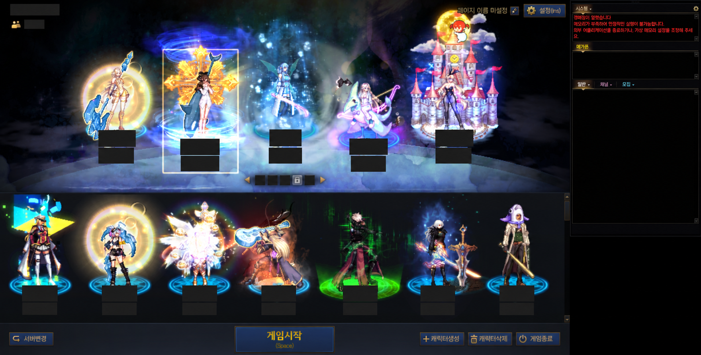
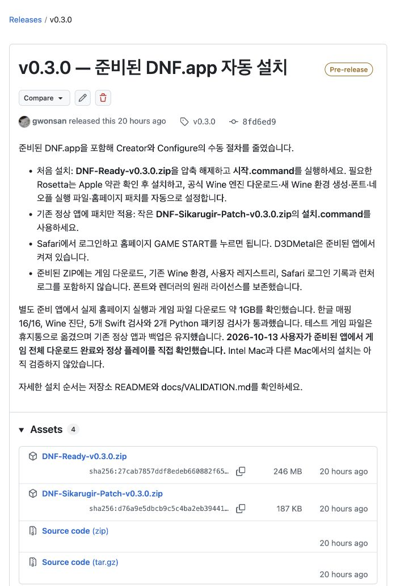
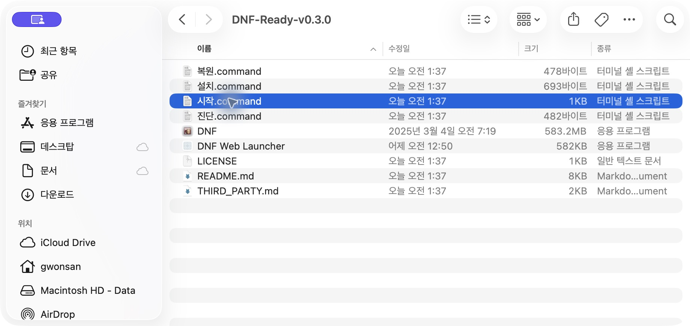
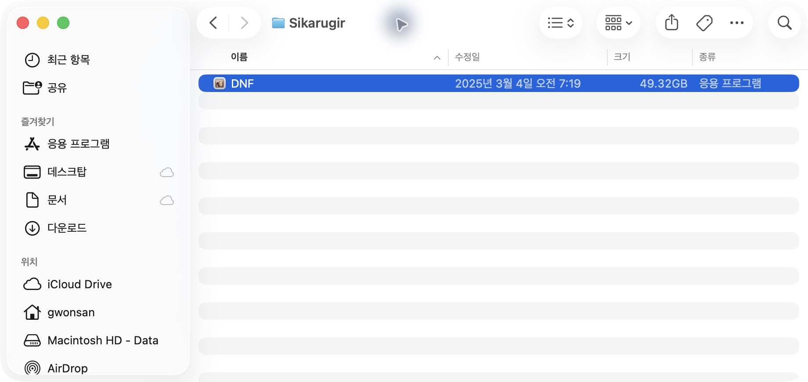

# DNF Sikarugir Patch

맥에서 Sikarugir로 한국 던전앤파이터를 설치하고 홈페이지의 **GAME START**로 실행하기 위한 도구입니다. **D3DMetal, 한글 폰트, 네오플 실행 파일과 홈페이지 연결**을 함께 준비합니다.



*Apple Silicon Mac · macOS 26.6.2 · Sikarugir Wine 11에서 캡처한 캐릭터 선택 화면. 계정·캐릭터 이름과 수치는 가렸습니다.*

## 개발 중: 하나의 던파 메뉴

`feat/keyboard-mapping`의 개발 빌드는 **`던파.command` 하나**로 시작합니다. 왼쪽에서 작업을 고르면 오른쪽에 설명과 설치 상태가 보입니다. 방향키와 Enter 또는 숫자로 설치·진단·복원을 실행하며, 좁은 창에서는 세로 메뉴로 전환됩니다. 필요한 세부 작업은 하위 메뉴에서 선택합니다. **아직 정식 배포본이 아니며, 아래 v0.3.3의 게임 플레이 검증이 이 개발 빌드의 검증을 뜻하지는 않습니다.**

1. 개발 ZIP 전체를 압축 해제한 뒤 `던파.command`를 더블클릭합니다. `설치 자료` 폴더를 옮기거나 그 안의 앱을 직접 실행하지 마세요.
2. 메뉴에서 필요한 작업을 선택하고 안내를 따릅니다. Rosetta가 필요하면 설치 작업을 선택했을 때 Apple 약관 동의를 안내합니다. 메뉴를 여는 것만으로 Rosetta를 설치하지 않습니다.
3. 설치가 끝나면 Safari에서 던파 홈페이지에 로그인하고 **GAME START**를 누릅니다.

```text
DNF-Ready-dev/                       DNF-Sikarugir-Patch-dev/
├── 던파.command                      ├── 던파.command
├── 설치 자료/                        ├── 설치 자료/
│   ├── DNF Web Launcher.app          │   └── DNF Web Launcher.app
│   └── DNF.app                      └── README·라이선스·안내 자료
└── README·라이선스·안내 자료
```

**종료:** TUI에서 `Q`를 누르거나 기존 설치·복원 명령이 정상 완료되면, 실행이 끝난 해당 터미널 창을 닫도록 요청합니다. 오류와 기존 진단 결과는 Enter로 확인한 뒤 닫습니다. 다른 작업이 있는 창, 여러 탭이 있는 창, 기존 셸에서 직접 실행한 경우는 자동으로 닫지 않습니다. Terminal 자동화 권한이 거부되면 창은 남으며 직접 닫을 수 있습니다.

처음 macOS가 차단하면 **시스템 설정 → 개인정보 보호 및 보안 → 그래도 열기**로 허용하거나, 직접 받은 파일을 신뢰하는 경우 압축 해제 폴더에서 `/bin/bash "./던파.command"`로 시작하세요. 진입 명령은 자기 자신과 동봉 도우미의 다운로드 격리 표시만 해제하며, 링크가 가리키는 외부 파일이나 macOS 전체 보안 설정은 바꾸지 않습니다. 도우미가 없으면 ZIP 전체를 다시 압축 해제하라는 오류를 표시합니다. 소스의 이전 명령 파일은 호환용으로 유지하지만 새 개발 ZIP에는 넣지 않습니다.

## 개발 중: 던파 전용 키 매핑

기존 설치가 있다면 게임과 런처를 종료한 뒤 새 개발 ZIP에서 **1 설치 / 패치 다시 적용**으로 웹 도우미를 먼저 업데이트하세요. 게임 파일을 다시 내려받는 작업은 아닙니다.

`던파.command` → **5 키보드 매핑**에서 키를 추가·변경·삭제합니다. 글자, 숫자, 방향키, F1–F20, 키패드와 좌우 보조 키를 목록에서 고를 수 있습니다. 서로 키를 교환하거나 여러 입력 키를 한 키에 지정할 수도 있습니다. Command·Option 해석은 **6 게임 설정 / Wine·그래픽**에서 바꾸며, 키 매핑에서도 Control·Alt를 직접 지정할 수 있습니다.

1. `R`을 누르면 **오른쪽 Option → 한/영 전환**, **Caps Lock → Caps Lock** 프리셋을 불러옵니다.
2. `P`를 눌러 시스템 설정에서 **DNF Keyboard / DNF 키보드 보정**의 **손쉬운 사용**(최신 macOS에서는 **기기 제어 및 데이터 접근**)과 **입력 모니터링**을 허용합니다. 권한은 동봉 보정기용이며 Karabiner 설치는 필요하지 않습니다.
3. `1`로 매핑을 켜고 `S`로 저장합니다. 사용자 지정은 `A` 추가, Enter 변경, `D` 삭제이며 Esc는 저장하지 않은 변경을 버립니다.
4. 홈페이지에서 게임을 시작합니다. 이미 게임이 실행 중이어도 `S`를 누르면 보정기를 시작합니다. 오른쪽 상태에 **던파 적용 중**과 실제 처리 방식이 표시되는지 확인하세요.

보정기는 선택한 앱 안에서 실행 중인 `DNF.exe`의 실제 파일 경로와 전경 PID를 확인한 뒤 적용합니다. Karabiner 규칙은 정확한 Wine 실행 파일 경로와 최대 0.5초짜리 허용 조건을 사용하며, 변환 결과를 받은 보정기가 대상 PID를 다시 확인합니다. 앱을 전환하면 누른 키를 해제하고 입력 연결을 닫습니다. Karabiner의 창 조건 자체에는 PID 조건이 없어 전환 순간의 짧은 입력 억제 경합은 남을 수 있습니다. 키 입력을 기록하지 않으며 macOS의 전역 키보드 설정이나 Wine·게임 실행 파일을 수정하지 않습니다. 설정을 끄고 `S`를 누르면 보정기가 종료되고, **물리 Control+Option+Escape**로도 긴급 중지할 수 있습니다. 긴급 중지 후에는 다시 `S`로 시작합니다.

`3`으로 **자동 선택 / Karabiner 우선 / 자체 매핑**을 고릅니다. 자동 선택은 게임 실행 시 Karabiner 16.3 이상과 CLI 응답을 확인합니다. 연결되면 Karabiner 규칙이 원하는 키와 동작으로 변환하고, 보정기가 변환 결과를 던파 PID에만 전달합니다. 길게 누르기·반복 입력·Caps 상태·한영 전환의 최종 처리는 보정기가 맡습니다. 원래 입력 키를 다시 매핑하지 않으므로 이중 변환이 생기지 않습니다.

Karabiner가 없거나 연결되지 않으면 자체 매핑을 시도하고 상태에 이유를 표시합니다. 기존 Karabiner 프로필과 사용자 규칙은 보존하며, 던파용 규칙만 추가하고 종료 시 제거합니다. 던파 안에서는 TUI 설정을 전체 지원 키의 기준으로 사용하고, 다른 앱에서는 기존 Karabiner 규칙이 그대로 적용됩니다. Simple Modifications가 필요한 입력 키를 먼저 바꾸면 충돌을 알립니다. 앱 전환 시 누른 키와 반복을 해제하고 전용 입력 연결을 닫습니다. 던파로 돌아오면 새 연결을 만들어 이전 입력을 거부합니다. 일반 F키나 Fn 조합을 내부 전달용으로 예약하지 않습니다.

한영 전환에는 macOS의 **이전 입력 소스 선택** 단축키가 켜져 있어야 합니다. 기본값은 **Control+Space**이며, 시스템 설정 → 키보드 → 키보드 단축키 → 입력 소스에서 확인합니다. 사용자가 단축키를 바꿨다면 현재 설정을 읽어 사용합니다. 패치가 macOS 단축키 설정을 변경하지는 않습니다.

**6 게임 설정 / Wine·그래픽**에서는 Command→Control, 좌우 Option→Alt, D3DMetal, CNC-DDraw를 바꿉니다. `S`는 설정을 저장하고, `P`는 저장한 설정을 적용합니다. 게임 실행 중에는 적용을 미루며 다음 홈페이지 실행 전에 자동 적용합니다. Wine·그래픽 변경은 게임을 새로 실행해야 반영됩니다. `R` 복원은 TUI가 바꾼 값만 원래대로 돌리고 나중에 사용자가 직접 수정한 값은 유지합니다. 키 매핑은 메뉴 5에서 별도로 끄거나 초기화하세요.

한/영 전환에는 macOS의 **두벌식 한국어와 ABC 또는 U.S. 입력 소스**를 사용합니다. OS가 먼저 처리하는 예약 단축키는 일반 키처럼 가로챌 수 없습니다.

개발 빌드를 바꾼 뒤 권한이 켜져 있는데도 동작하지 않으면, 두 권한 목록에서 **DNF Keyboard만 제거한 뒤 현재 설치된 앱을 다시 추가**해 주세요. 임시 서명이 바뀌면 기존 허용 기록이 이전 빌드를 가리킬 수 있습니다. 앱 위치는 `~/Applications/DNF Web Launcher.app/Contents/Resources/DNF Keyboard.app`입니다. Caps Lock 장치 접근 실패가 계속되면 기존 Karabiner 등 키보드를 독점하는 보정 앱이 실행 중인지 확인하세요.

**2026-10-31 통합 개발 빌드를 실제 설치하고 홈페이지 실행과 마을 접속을 확인했습니다.** Karabiner 연결 상태에서 사용자의 물리 키로 A→B 매핑, Caps Lock 대소문자 고정, 오른쪽 Option 한영 전환을 확인했습니다. 키를 누른 채 Command+Tab으로 전환해도 복귀 후 반복 입력이 남지 않았습니다. 연결 만료 시 키 해제·종료, 같은 Wine의 메모장 제외, 게임 실행 중 그래픽 설정 적용 보류도 확인했습니다. Karabiner를 종료한 자체 매핑에서도 같은 물리 입력 결과를 확인하고 원래 설정으로 복원했습니다. 장시간 입력과 Intel 실기기 검증은 남아 있습니다. 자세한 범위는 [검증 기록](docs/VALIDATION.md)을 참고하세요. 기존 v0.3.3의 플레이 확인과는 별개입니다.

## 배포된 v0.3.3 사용 안내

**아래 `시작.command` 등 여러 명령 파일을 사용하는 설치 안내와 화면은 정식 배포된 v0.3.3 기준입니다. 개발 ZIP은 위의 `던파.command` 메뉴를 사용하세요.**


**2026-10-16: v0.3.3의 정상 동작을 사용자가 직접 검증했습니다.**

v0.3.0은 2026-10-13 기준 Apple Silicon Mac · macOS 26.6.2 · Sikarugir Wine 11 환경에서 홈페이지 실행과 한글 표시가 정상 작동하며, **준비된 DNF.app에서도 게임 전체 다운로드 완료와 정상 플레이를 사용자가 직접 확인했습니다.** 검증 범위는 [VALIDATION.md](https://github.com/gwonsan/dnf-sikarugir-patch/blob/main/docs/VALIDATION.md)에 기록합니다.

## 가장 간단한 설치

1. [Releases](https://github.com/gwonsan/dnf-sikarugir-patch/releases)에서 `DNF-Ready-v0.3.3.zip`을 받아 압축을 풉니다.
2. 폴더 안의 `시작.command`를 더블클릭합니다. Rosetta가 없으면 Apple 설치 창의 약관을 확인하고 동의합니다. 이후 공식 템플릿·Wine을 받아 이 Mac에서 앱과 Windows 환경을 만들고 패치를 적용합니다. ZIP 안의 `DNF.app`을 직접 실행하지 마세요.
3. 설치가 성공하면 압축 해제 폴더의 준비용 `DNF.app`은 휴지통을 거치지 않고 삭제됩니다. 설치된 앱과 게임 파일은 유지됩니다.
4. 열린 던파 홈페이지에서 **Safari로 로그인하고 GAME START**를 누릅니다. 브라우저의 외부 앱 실행 확인을 허용하고 게임을 내려받습니다.

**처음 실행할 때 macOS가 차단하면**

이 저장소에서 받은 `시작.command` 또는 `DNF Web Launcher`에 “개발자를 확인할 수 없다”거나 “악성 소프트웨어가 있는지 확인할 수 없다”는 경고가 나오면 다음 순서로 허용하세요.

1. 파일 실행을 한 번 시도한 뒤 **시스템 설정 → 개인정보 보호 및 보안**으로 이동합니다.
2. 아래로 스크롤하여 **보안** 영역의 해당 파일 차단 안내 옆 **그래도 열기**를 누릅니다.
3. 인증을 요청하면 진행하고, 확인 창에서 **열기**를 누릅니다. 설치가 다시 시작되지 않으면 `시작.command`를 다시 실행하세요.

`그래도 열기`가 보이지 않으면 해당 파일 실행을 다시 시도한 후 설정을 확인하세요. [Apple 공식 안내](https://support.apple.com/ko-kr/102445)

### 설정 대신 터미널에서 시작하기

v0.3.3의 `시작.command`, `설치.command`, `처음설치.command`에는 실행 허용 처리가 들어 있습니다. 실행하면 **해당 명령 파일·패치 도우미·설치 대상 DNF.app의 다운로드 격리 표시(`com.apple.quarantine`)를 자동으로 제거**한 뒤 설치합니다. 다른 폴더를 가리키는 링크는 따라가지 않으며, macOS 전체 보안 설정을 바꾸지 않습니다.

다만 **차단된 `.command`는 자기 안의 명령을 실행할 수 없습니다.** 최초 한 번은 위의 **그래도 열기**를 사용하거나, 직접 받은 설치 파일을 신뢰한다면 다음과 같이 터미널에서 시작하세요.

1. **터미널**을 열고 `cd `를 입력합니다(뒤에 공백 포함). 압축을 푼 **DNF-Ready 폴더**를 터미널로 끌어 놓고 Enter를 누릅니다.
2. 아래 명령을 붙여 넣고 Enter를 누릅니다. 실행 허용 처리부터 설치까지 이어서 진행합니다.

```sh
/bin/bash "./시작.command"
```

기존 앱에 패치만 적용하려면 작은 패치 ZIP의 압축 해제 폴더에서 `/bin/bash "./설치.command"`를 실행하세요. 빈 앱부터 수동 설치할 때는 `/bin/bash "./처음설치.command"`를 사용합니다. 격리 표시 해제 자체에는 관리자 암호가 필요하지 않지만, 대상 파일의 쓰기 권한이 없으면 오류를 표시하고 중단합니다.

이 처리는 Apple 서명·공증을 추가하거나 실제로 손상된 파일을 고치는 기능이 아닙니다. 이 저장소의 [공식 Releases](https://github.com/gwonsan/dnf-sikarugir-patch/releases)에서 직접 받은 파일을 신뢰하는 경우에만 실행하세요. “컴퓨터를 손상시킵니다” 같은 악성코드 감지 경고에는 사용하지 마세요. 파일이 실제로 손상됐거나 출처가 불분명하면 다시 내려받으세요. 회사·학교 관리 정책 등 다른 차단 원인까지 해제하지는 않습니다.

**설치된 DNF.app에 “손상되었기 때문에 열 수 없습니다”가 뜬다면**

압축을 푼 폴더의 `DNF.app`은 설치 재료입니다. 이를 직접 열지 말고 `시작.command`로 설치하세요. 설치가 끝난 **사용자 홈 → Applications → Sikarugir → DNF.app**에서 다운로드 격리로 인한 경고가 발생했다면, 출처를 확인한 뒤 해당 앱에만 다음 명령을 적용할 수 있습니다.

```sh
/usr/bin/xattr -drs com.apple.quarantine "$HOME/Applications/Sikarugir/DNF.app"
```

설치 위치를 직접 바꿨다면 마지막 경로도 바꾸세요. 완료 후 Safari에서 GAME START를 다시 누릅니다. 격리 표시를 제거해도 실제 파일 손상, 잘못된 서명 또는 다른 차단 원인에 의한 경고가 해결되는 것은 아닙니다. 같은 경고가 계속되면 명령을 반복하기보다 오류와 설치 로그를 확인하세요.

정상 실행 시 패치 도우미는 안내 창이나 Dock 아이콘 없이 실행 요청을 전달합니다. 실행 요청 전달에 실패하면 오류 창이 표시됩니다.

**60초 설치 안내 영상**

https://github.com/user-attachments/assets/e18cd303-6cdd-4ce7-a436-aa5dc20c9b9b

[영상 다운로드 · MP4](https://github.com/gwonsan/dnf-sikarugir-patch/releases/download/v0.3.0/DNF-Install-Guide-v0.3.0.mp4)

실제 화면 캡처와 단계별 자막으로 만든 요약 영상입니다. 영상과 아래 화면은 v0.3.0 기준입니다. v0.3.3도 설치 순서는 같고, 설치 완료 후 준비용 앱이 바로 삭제됩니다. 파일 다운로드·자동 설치·게임 다운로드에는 별도의 시간이 필요합니다.

<details>
<summary><strong>설치 화면 4장으로 따라하기</strong></summary>

### 1. 준비된 ZIP 다운로드

[v0.3.3 배포 페이지](https://github.com/gwonsan/dnf-sikarugir-patch/releases/tag/v0.3.3)의 **Assets → DNF-Ready-v0.3.3.zip**을 선택합니다. 처음 설치할 때는 준비된 DNF.app이 포함된 큰 ZIP을 받으세요.



### 2. 압축을 풀고 시작.command 실행

받은 ZIP을 더블클릭해 압축을 푼 뒤, 폴더 안의 **시작.command**를 더블클릭합니다. 필요한 파일을 폴더 안에 함께 둔 상태로 실행하세요.



### 3. 자동 설정 완료 기다리기

Rosetta가 없으면 Apple 약관을 확인하고 직접 동의합니다. Wine 설치, 새 Wine 환경 생성, 폰트·네오플 실행 파일·홈페이지 연결은 자동으로 진행됩니다. 터미널에 다음 메시지가 나오면 다음 단계로 넘어갑니다.

> 설정 완료. 열린 던파 홈페이지에서 로그인하고 GAME START를 눌러 주세요.

기본 설치 위치는 **사용자 홈 → Applications → Sikarugir → DNF.app**입니다. 아래는 정상 설치된 앱의 위치 예시입니다. 촬영한 앱에는 이미 게임 파일이 내려받아져 있어 설치 직후보다 크기가 큽니다.



### 4. Safari 로그인 후 홈페이지에서 실행

[던파 홈페이지](https://df.nexon.com)를 Safari로 열고 로그인합니다. 오른쪽 위의 **모험시작** 버튼(GAME START)을 누르고 외부 앱 열기를 허용하세요. 네오플 창에서 설치 경로를 확인한 뒤 게임 다운로드를 진행합니다. 다운로드가 끝나면 게임에 접속할 수 있습니다.


로그인 입력과 OTP 인증은 직접 진행하세요. 안내 화면에는 로그인 정보와 인증번호를 담지 않았습니다.

</details>

Sikarugir Creator에서 빈 앱을 만들거나 Configure를 열고 플러그인 설치 버튼을 누르는 절차를 미리 준비한 패키지입니다. 기본 설치 위치는 `~/Applications/Sikarugir/DNF.app`입니다. Xcode나 별도 Wine 설치 명령은 필요하지 않습니다.

필요한 환경은 macOS 14.6 이상과 인터넷 연결입니다. Apple Silicon에서는 Rosetta를 사용합니다. 게임용 저장공간은 [공식 다운로드 안내](https://df.nexon.com/data/client)를 확인하세요. 패치 도우미는 임시 서명을 사용하며 Apple 공증은 되어 있지 않습니다. macOS가 명령 파일을 차단하면 **시스템 설정 → 개인정보 보호 및 보안 → 보안 → 그래도 열기**에서 해당 파일을 허용하세요.

## 준비된 앱에 들어 있는 것

| 준비된 ZIP에 포함 | 설치 시 준비하거나 사용자가 진행 |
| --- | --- |
| 공식 Sikarugir Template 1.0.21의 앱과 Configure | 공식 템플릿·Wine 11 다운로드 및 SHA-256 검증 |
| D3DMetal 설정과 템플릿의 렌더러·라이선스 | 이 Mac에 맞는 새 Wine 환경 생성 |
| Source Han Sans 폰트와 SIL OFL 라이선스 | 일본어·한글 폰트 등록 및 홈페이지 실행 연결 |
| 공식 네오플 실행 파일 두 개와 패치 도우미 | 필요한 경우 Rosetta 약관 동의 |
| 설치·복원·진단 명령 파일 | Safari 로그인과 GAME START, 게임 다운로드 |

게임 파일, Wine 엔진, 기존 Mac의 Wine 레지스트리·사용자 환경과 런처 로그는 배포본에 포함하지 않습니다. 동봉 앱에서는 폰트·네오플 파일과 라이선스를 읽습니다. 실행할 앱은 고정된 SHA-256으로 검증한 공식 템플릿·Wine으로 설치받는 Mac에서 조립합니다. `Contents/drive_c`는 `SharedSupport/prefix/drive_c`를 가리키는 상대 링크이며, 실제 Windows 파일과 레지스트리는 초기화 단계에서 생성합니다. **Safari 쿠키와 로그인 기록은 앱에 복사하지 않습니다.** 홈페이지에서 받은 실행 요청은 공식 네오플 실행 파일에 그대로 전달하며 패치 도우미는 인증 URL을 기록하지 않습니다.

폰트는 Configure의 `fakejapanese`와 같은 Source Han Sans 및 일본어 매핑을 등록하고, 한글 글꼴 대체 이름 16개를 Source Han Sans K로 연결합니다. D3DMetal은 미리 켜져 있습니다. 배포 구성과 각 파일의 출처·라이선스는 [THIRD_PARTY.md](THIRD_PARTY.md)에 있습니다.

설치와 홈페이지 연결이 모두 성공하면 준비용 앱만 휴지통을 거치지 않고 영구 삭제합니다. 실패한 경우에는 재시도할 수 있게 남겨두며, 준비용 앱 삭제를 완료하지 못해도 설치 성공은 유지되며 오류를 안내합니다. 설치된 앱과 준비용 앱의 경로가 겹치거나 준비용 앱에 Windows 환경이 생긴 경우에는 자동 정리하지 않습니다. 준비용 앱이 없어도 기존 설치가 정상이면 `시작.command`를 다시 실행할 수 있습니다. 새로 설치하거나 복구에 필요한 파일이 없으면 ZIP을 다시 압축 해제하세요.

기존 앱을 덮어쓰지 않습니다. 현재 패치가 같은 경로의 정상 앱에 연결돼 있으면 그 앱에 홈페이지 패치만 다시 적용합니다. 다른 앱에 적용한 패치가 있으면 먼저 `복원.command`를 실행하세요. 새 앱 준비 도중 중단됐다면 같은 명령을 다시 실행해 이어서 진행합니다. v0.3.1 이하에서 복사된 앱의 Windows 환경이 미완성인 경우, 해당 Wine이 종료된 것을 확인하고 앱 전체를 같은 폴더의 `DNF-before-v0.3.2-….app`으로 보관한 뒤 새로 조립합니다. 정상 초기화된 기존 앱은 재생성하지 않습니다.

새 설치 위치를 지정할 수도 있습니다.

```sh
bash 시작.command "$HOME/Applications/Sikarugir/DNF.app"
```

## 이미 정상 작동하는 앱에 패치만 적용

작은 `DNF-Sikarugir-Patch-v0.3.3.zip`에는 준비된 DNF.app이 없습니다. 이 ZIP은 기존 앱 패치나 아래의 수동 설치 경로에 사용합니다.

1. `설치.command`를 더블클릭합니다. 기본 경로의 `DNF.app`을 찾고, 없으면 앱 선택 창이 뜹니다.
2. 설치 완료 후 홈페이지에서 로그인하고 **GAME START**를 누릅니다.
3. 실행 중 폰트 설정을 바꿨다면 런처를 종료하고 다시 실행해 반영합니다.

대상 앱에는 Sikarugir Wine 11과 공식 네오플 플러그인 `NeopleCustomURLStarter.exe`가 있어야 합니다. Source Han Sans가 없으면 Configure → Winetricks에서 `fakejapanese`를 먼저 적용하세요. 기존 앱 패치는 Info.plist, 실행 위치와 렌더러 선택을 유지합니다.

```sh
bash 설치.command "/path/to/DNF.app"
```

## 빈 앱부터 직접 설치하는 방법

준비된 앱을 사용하면 이 절차는 필요하지 않습니다. 설치 파일부터 직접 진행하려면 작은 패치 ZIP의 `처음설치.command`를 실행합니다. 공식 템플릿·Wine 11·폰트를 받아 빈 앱을 만든 뒤 공식 `NeopleCustomURLBuilder.exe`를 선택합니다. **Wine의 네오플 설치 창에서 ‘설치’를 직접 눌러야 합니다.** 완료하면 실행 위치와 홈페이지 패치를 설정합니다.

Sikarugir Creator에서 직접 작업할 때의 순서는 다음과 같습니다.

1. [공식 Sikarugir Creator](https://github.com/Sikarugir-App/Sikarugir)에서 `WS12WineSikarugir11.0_1`을 선택하고 빈 `DNF.app`을 만듭니다.
2. 만든 앱의 Configure → Configuration에서 **Direct3D to Metal translation layer** 옵션(D3DMetal)을 체크합니다.
3. Winetricks → fonts → **fakejapanese → Run**을 실행합니다.
4. Install Software → Choose Setup Executable에서 공식 `NeopleCustomURLBuilder.exe`를 선택합니다.
5. Wine 설치 창의 **‘설치’**를 눌러 완료합니다.
6. Choose Executable에서 `C:/Program Files (x86)/NeoplePlugin/NeopleCustomURLStarter.exe`를 선택합니다.
7. 패치의 `설치.command`를 실행하고 홈페이지의 **GAME START**를 누릅니다.

## 처음 설치가 멈추거나 손상 경고가 나온 경우

v0.3.1 이하에서 `이 Mac에 맞는 Wine prefix 초기화 중…`에 멈췄다면 기존 설치·Wine 창을 종료하고 **최신 버전의 `시작.command`**를 실행하세요. v0.3.2는 다운로드된 DNF 앱을 그대로 실행하지 않고 공식 자료로 새 앱을 조립합니다. v0.3.3은 설치 명령 파일·도우미와 설치 대상 앱의 격리 표시만 자동 제거합니다. macOS 전체 보안 설정은 바꾸지 않습니다. Apple 공증을 받은 배포본은 아니므로 명령 파일·도우미에 대한 macOS 실행 허용이 필요할 수 있습니다.

초기화에는 최대 5분 정도 걸릴 수 있습니다. 성공하려면 레지스트리 두 개, `cmd.exe`, 32비트·64비트 Program Files 폴더가 모두 있어야 합니다. 파일이 부족하면 폰트·플러그인 설치로 넘어가지 않고 오류를 표시합니다. 초기화 로그 위치도 터미널에 출력합니다.

```text
~/Applications/Sikarugir/DNF.app/Contents/SharedSupport/Logs/DNF-prefix-init.log
```

오류가 계속되면 macOS 버전·칩 종류와 초기화 로그를 확인하세요. 이 로그는 Windows 환경 생성 단계에만 사용하며 홈페이지 인증 URL을 기록하지 않습니다.

## 복원과 진단

`진단.command`는 Wine 실행, 한글 매핑 수와 현재 홈페이지 연결을 확인합니다. DNF Web Launcher를 닫고 `복원.command`를 실행하면 패치가 바꾼 폰트 매핑과 이전 URL 처리 앱을 복원합니다. 이후 사용자가 따로 바꾸거나 삭제한 폰트 설정은 유지합니다.

최초 백업은 `~/Library/Application Support/DNF Sikarugir Patch/state.plist`에 저장하며 재설치 때 덮어쓰지 않습니다. 설치·복원은 동시에 겹치지 않도록 잠금을 사용합니다. 복원은 만들어진 DNF.app, 게임, 플러그인·폰트나 설치 자료를 삭제하지 않습니다.

### 다음 버전 준비 중: 복구와 실행 안정성

아래 기능은 `fix/installer-recovery`에서 이어받은 개발 변경 사항이며, 배포된 v0.3.3에는 아직 포함되지 않았습니다. 새 개발 ZIP에서는 `던파.command`의 복원 메뉴를 사용합니다. 아래 직접 명령은 소스에 남겨 둔 호환용 명령 파일 기준입니다.

- 설치된 DNF.app을 삭제하거나 이동해 기존 경로에서 찾을 수 없으면, `복원.command`가 폰트 복원을 건너뛰고 남은 연결과 설치 기록을 정리합니다. 기존 설정은 `~/Library/Application Support/DNF Sikarugir Patch/Recovery/`에 별도 백업하며, 이후 새 경로에 설치할 수 있습니다. 이동한 앱의 폰트까지 복원하려면 먼저 앱을 원래 위치로 돌려놓고 일반 복원을 실행하세요.
- 앱은 남아 있지만 Wine이 손상되어 일반 복원이 실패하면, 아래 명령으로 **연결과 설치 기록만** 정리할 수 있습니다. 폰트 설정은 복원하지 않으며 원래 백업을 `Recovery/`에 보관합니다. 게임 파일은 삭제하지 않습니다. 터미널에서 패치 폴더로 이동한 뒤 실행하세요.

  ```sh
  /bin/bash ./복원.command --connection-only
  ```

- 웹 실행 도우미는 전달한 실행 요청이 모두 끝나면 자동 종료합니다. 오류가 있으면 확인할 수 있도록 창을 유지하며, 이미 별도로 실행된 게임이나 다운로드는 종료하지 않습니다.
- 설치·복원 도중에는 홈페이지 실행 요청을 시작하지 않습니다. 작업이 끝난 뒤 GAME START를 다시 누르면 됩니다. 실행 요청을 처리하는 중에도 설치·복원이 겹치지 않도록 합니다.
- 다운로드 캐시의 SHA-256이 다르면 해당 캐시만 지우고 다시 받습니다. 새 파일도 검증에 실패하면 실행하지 않고 중단합니다.


Intel용 패치 실행 파일도 포함하지만 Intel Mac 실기기와 두 번째 Mac에서의 전체 설치는 아직 검증하지 않았습니다. 다운로드 완료와 정상 플레이 확인은 위 환경 기준입니다.

## 소스에서 개발 빌드

Xcode Command Line Tools가 설치된 Mac에서 실행합니다.

```sh
bash scripts/test.sh
bash scripts/build.sh
```

결과는 arm64와 x86_64를 포함하는 `dist/DNF-Sikarugir-Patch-dev.zip`과 `dist/DNF-Sikarugir-Patch-dev/`입니다. 매번 빈 임시 폴더에서 패키지를 구성해 이전 명령 파일이 섞이지 않게 하며, 기존 v0.3.3 배포 파일은 덮어쓰지 않습니다. 준비된 앱 패키지는 검증된 공식 템플릿과 폰트, 설치된 공식 플러그인 파일 두 개를 지정해 별도로 만듭니다.

```sh
python3 scripts/package-ready.py \
  --template /path/to/Template-1.0.21.tar.xz \
  --font /path/to/sourcehansans.ttc \
  --plugin-directory /path/to/NeoplePlugin \
  --font-license /path/to/SourceHanSans-OFL.txt \
  --destination build/prepared/DNF.app
bash scripts/build-ready.sh
```

기존에 준비한 앱을 입력하려면 `bash scripts/build-ready.sh "/path/to/DNF.app"`로 지정합니다. 입력 파일의 고정된 SHA-256을 확인하고, 사용한 앱의 Wine 환경을 복사하지 않습니다. 결과는 `dist/DNF-Ready-dev.zip`과 `dist/DNF-Ready-dev/`입니다. 소스 저장소에는 게임·Wine 바이너리, 사용자 레지스트리·백업과 인증 로그를 넣지 않습니다. 패치 자체 코드는 MIT이며 동봉한 구성 요소에는 각 배포처의 라이선스가 적용됩니다.
